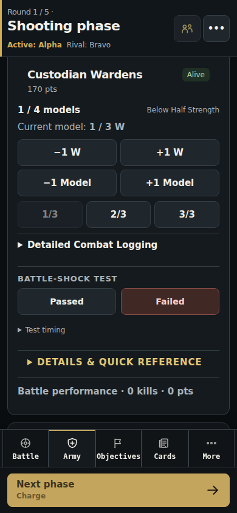
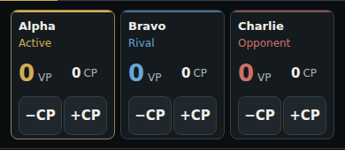
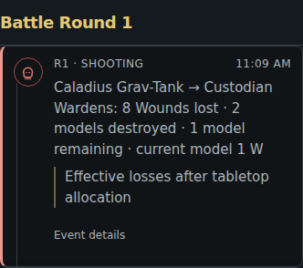
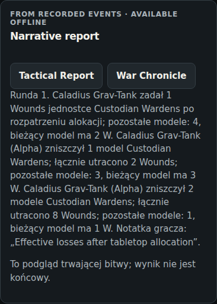

# Combat Logging 2.0 — review

Continuation of UI 2.0 on `feat/tabletophelper-ui-2`, PR #23. This review uses synthetic test rosters, not current points costs or a real match. Main has not been merged.

## At the table

Army Tracker, Recently used, Army Quick Access and Damage Opponent share the same combat controls. Pick the source once, then use a single tap for −1 W or −1 Model. Owners can heal the current model or restore models. Small Wounds profiles have remaining-Wounds presets; Detailed Combat Logging accepts larger amounts, multiple explicit model profiles and an optional note.

Enter **Wounds actually lost after saves, allocation and other tabletop rules**. The app does not roll attacks, allocate nominal weapon Damage or decide whether damage carries between models. One confirmation records one resolved attack.

For different Wounds profiles, select the receiving profile or allocate amounts to each profile in one detailed resolution. Leaders stay separate from bodyguards. Missing Wounds or ambiguous survivors from old saves require confirmation through **Battle menu → Correct battle state → Combat profiles / current model Wounds**. In shared games that correction belongs to the host.

Healing never revives a destroyed unit. Returning a destroyed unit requires the separate return control or the explicit detailed Restore operation. Restoring models preserves the already wounded surviving model. Corrections have their own history entry and do not count as healing or reanimation.

## Recorded example

Caladius Grav-Tank attacks Custodian Wardens, initially 4 models with 3 Wounds each:

| Recorded operation | Surviving models | Current model | Total effective Wounds lost |
| --- | --- | --- | --- |
| −1 W | 4 / 4 | 2 / 3 W | 1 |
| Apply 2 W | 3 / 4 | 3 / 3 W | 3 |
| Apply 8 W as one attack | 1 / 4 | 1 / 3 W | 11 |

The last operation produces one Chronicle entry: **Caladius Grav-Tank → Custodian Wardens: 8 Wounds lost · 2 models destroyed · 1 model remaining · current model 1 W**. The attack note is retained. The report records 11 effective Wounds, three net model casualties and no unit kill. At the fixture's 170 points per squad, casualty value is 127.5 points; partial Wounds do not add points or ROI.

The mobile regression then heals 1 W, restores one model without resetting the wounded survivor, reloads the save, records a host correction and closes an unresolved legacy HOLD.

[Example Battle Report](example-report.md) · [Structured report](example-report.json)

### Army Tracker — 390 × 844

### Direct CP controls

### One attack in Chronicle

### Report derived from the same history

## State, history and multiplayer

`UNIT_COMBAT_RESOLVED` carries the target, operation, explicit profile allocations and optional attacker/note. It is additive, not an absolute replacement of unit state, so separately recorded offline losses survive canonical replay. State, Chronicle, casualties, final kills, statistics and report use the existing event history.

Derived Cauldron elimination consequences are reconstructed at the canonical lethal transition. They share the combat action, have deterministic IDs and are not separately uploaded. Repeated delivery and two offline clients both predicting a lethal hit therefore cannot duplicate the automatic award. Local undo/redo replays the whole action. Shared controls offer authorized host corrections instead of an unsafe undo.

The owner can change their army; the active attacker can record attributed opponent damage, but cannot heal the opponent. Existing shared authorization and transport remain in place. No database migration or dependency was added. All participating phones must refresh to this version before using new combat events; older clients do not understand the new event type.

Old event types and saves still replay. Ambiguous old heterogeneous casualties are not assigned to profiles by guessing. Legacy HOLD state remains readable and can be closed by its requester or the host. The manual HOLD UI, store entry points and unused controls are removed. Automatic reaction windows, timing validation and stratagem costs remain. Opponent Stratagems allows direct use after confirming valid tabletop timing without opening a manual pause.

## Validation and limits

| Check | Result |
| --- | --- |
| `npx tsc --noEmit` | Passed |
| `npm test -- --run` | 496 tests in 63 files passed |
| `npm run build` | Passed |
| `npm run test:e2e` | All 37 scenarios passed in one full run |
| Final confirmed-Wounds strength fix | Unit suite, typecheck, build and both combat browser scenarios passed again |
| `git diff --check` | Passed |

The unit suite covers partial Wounds, overkill, healing, death, restoration, mixed profiles, separate Leaders, missing import data, corrections, final kills, split fire, net ROI, undo/redo, duplicate event delivery, concurrent lethal attacks and authorization. Browser coverage includes the full mobile attack/report/correction flow and a regression ensuring quick buttons ignore an open detailed multi-profile draft.

The three-phone browser scenario uses the real REST client against a deterministic Supabase API fixture: two phones independently record damage while offline, reconnect with a lost acknowledgement, and all three converge on both losses exactly once. A third unauthorized commander is rejected. This is not a live Supabase or physical-device validation; those checks remain for the planned tabletop session.

- Wounds statistics are explicitly **Partial** (recorded damage) or **Unknown**. Model-only losses and old whole-unit kills do not invent damage.
- Healing/restoration preserve historical gross Wounds. Corrections retract erroneous losses; restored models retract net casualty value and final kills. Point value still uses the existing equal-cost-per-model estimate.
- One wounded survivor is tracked per Wounds profile. The app does not infer model-level special allocation rules or unknown imported characteristics.
- Attached-unit Below Half Strength requires table confirmation; the app avoids guessing combined Leader/bodyguard strength.
- Recent targets, status labels, detailed logging and immediate attack summaries are included. A separate two/three-item activity feed is deferred; Latest table update and Chronicle remain available.
- The pre-existing large JavaScript chunk warning remains. UI 2.0's previously documented official-objective geometry limits also remain.

To reproduce captures: `CAPTURE_COMBAT=1 npm run test:e2e -- e2e/combat-logging.spec.ts`.
